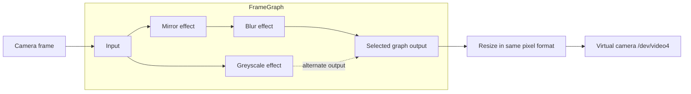

# LinuxStudioEffects

An open-source Linux alternative to **Windows Studio Effects** designed to run real-time camera and microphone AI effects on **AMD Ryzen AI NPUs** (using [MLIR-AIE / IRON](https://github.com/Xilinx/mlir-aie) and a standalone XRT userspace runtime).

## Project Structure

```text
LinuxStudioEffects/
├── setup_ironenv.py                  # Self-contained NPU environment setup & verification
├── pyproject.toml
├── src/
│   └── linux_studio_effects/
│       ├── npu/                      # NPU hardware/driver probing & runtime helpers
│       ├── video/                    # Camera effects (blur, framing, eye contact, lighting, filters)
│       └── audio/                    # Microphone effects (Voice Focus)
└── tests/
    └── test_npu_smoke.py             # End-to-end NPU detection & IRON kernel smoke test
```

## Quickstart

### Effect layout and composition

Effects are grouped by behavior under `video/effects/<effect>/`. A backend is
implemented only when its file exists (`cpu.py`, `gpu.py`, or `npu.py`); use
`available_effect_backends()` to inspect the catalog and `load_effect_backend()`
to import a backend lazily. `create_effect("portrait_blur")` selects the best
implemented backend available on the host (NPU, then GPU, then CPU). Shared
model code remains under `video/models/`.

`FrameGraph` lets a node consume the camera frame (`input`) or a prior node's
output, and its selected output is passed to the existing virtual-camera sink:

```python
from linux_studio_effects.video import FastBlurEffect, FrameGraph, MirrorEffect, PipelineConfig, VideoPipeline

graph = FrameGraph()
graph.add("mirror", MirrorEffect())
graph.add("blur", FastBlurEffect(), source="mirror")
graph.set_output("blur")
VideoPipeline(PipelineConfig(), effect=graph).run()
```

The camera frame enters the graph, graph nodes can consume the camera or an
earlier node, and the selected output continues through the pipeline to the
virtual camera. Live capture carries packed `YUYV`, `UYVY`, `RGB3`, or `BGR3`
frames through this path unchanged. The camera and loopback must negotiate the
same FourCC, colorspace, YCbCr encoding, and quantization range; V4L2 default
values are resolved before comparison because loopback drivers may report
defaults instead of explicit fields. The pipeline does not decode or convert
between color spaces. Output resizing operates on the original packed format.



### Prerequisites
- Linux (`x86_64`) with kernel >= 6.14 (`amdxdna` driver exposing `/dev/accel/accel*` with read/write permissions)
- Python 3.14 (or `uv`) and `git` for NPU setup; the standalone bundle includes XRT, `pyxrt`, and `xclbinutil`
- No system `xrt` or `xrt-plugin-amdxdna` packages required

### Setup `.ironenv` and verify NPU execution

```bash
python3 setup_ironenv.py
```

The setup script defaults to `/home/tdynamos/amdnpu/dist/ryzen-ai-xrt-npu1-linux-x86_64.tar`.
If the bundle is elsewhere or hosted at a URL with a matching `.sha256` sidecar,
pass `--xrt-bundle PATH_OR_URL`.

Activate in your shell:

```bash
# bash / zsh
source .ironenv/bin/activate

# fish
source .ironenv/bin/activate.fish
```

Run the NPU smoke test:

```bash
python3 tests/test_npu_smoke.py
```

## TODO

### NPU Runtime & Core Pipeline
- [x] Self-contained `.ironenv` setup (`mlir_aie`, `llvm-aie`, standalone XRT, `pyxrt`, `xclbinutil`)
- [x] `/dev/accel/accel*` & `amdxdna` preflight detection and NPU smoke test
- [ ] Validate across NPU generations (Phoenix/Hawk Point NPU1, Strix Point/Krackan NPU2)
- [ ] Zero-copy / persistent DMA ring buffer pipeline for real-time video & audio frames
- [ ] Custom AIE2 / AIE2p vectorized C++ kernels for image convolutions, resize/warp, and FFT/DSP

### Video & Camera Effects
- [ ] **Background Blur (Standard Blur):** Fast segmentation + Gaussian background blur
- [ ] **Portrait Blur:** Smooth depth/edge-aware bokeh background blur
- [ ] **Automatic Framing:** Real-time face detection with smooth pan, crop, and zoom tracking
- [ ] **Eye Contact (Standard):** Subtle gaze redirection toward the camera
- [ ] **Eye Contact (Teleprompter):** Continuous gaze correction while reading across the screen
- [ ] **Portrait Light:** Low-light face illumination and exposure balancing
- [ ] **Creative Filters:** Stylized real-time filters (*Illustrated*, *Animated*, *Watercolor*)

### Audio Effects
- [ ] **Voice Focus:** Real-time microphone noise suppression and voice isolation on the NPU

### Linux Desktop & System Integration
- [ ] Virtual webcam output (PipeWire / `v4l2loopback`) compatible with OBS, Zoom, Google Meet, Teams, Discord
- [ ] Virtual microphone filter node (PipeWire audio filter chain)
- [ ] Support for both built-in laptop webcams and external USB cameras
- [ ] Live toggle CLI (`lse-ctl`) and desktop Quick Settings / system tray UI
